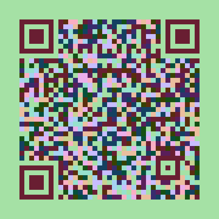
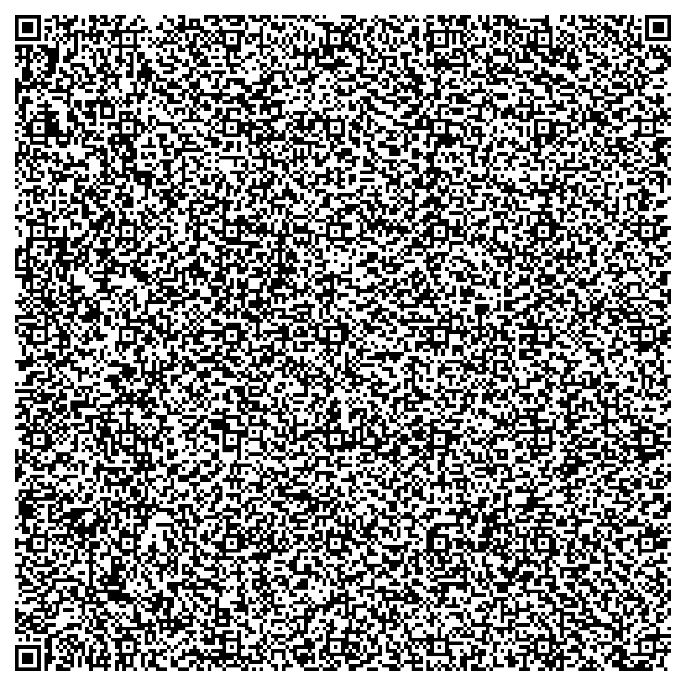
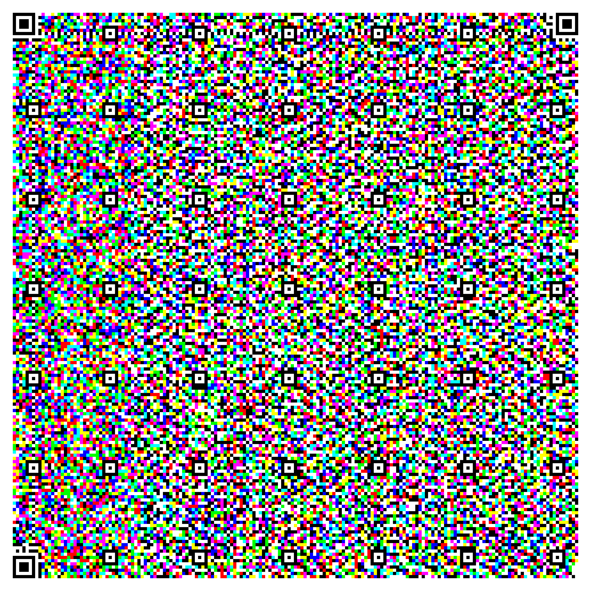

<p align="center">
  <br>
  <strong>Scan this with a normal QR reader:</strong> it resolves the ordinary compatibility layer.<br>
  ChromaQR decodes the independent colour payload shown below.
</p>

# ChromaQR

ChromaQR stores data in colour QR layers. The current **format-v2 compatible mode** keeps a clean standards-compliant QR code in luminance while encoding a separate, integrity-checked payload with two luma-balanced eight-colour codebooks. Ordinary QR scanners see the compatibility payload; ChromaQR sees the colour payload.

The demo above contains:

- ordinary layer: `https://your-domain.example/chromaqr`
- colour layer: `Hi Duarte! You found the hidden ChromaQR layer. A normal scanner only sees the self-hosted app link; colour reveals this message.`

## Install and prerequisites

ChromaQR requires Python 3.9+ and the native `zbar` library used by `pyzbar`:

```sh
# Debian/Ubuntu
sudo apt-get install libzbar0

# macOS
brew install zbar

# then install ChromaQR
pip install "git+https://github.com/w-henderson/ChromaQR.git#egg=ChromaQR"
```

Windows `pyzbar` wheels normally include the required DLLs. See the [pyzbar installation notes](https://pypi.org/project/pyzbar/) if loading zbar fails.

## CLI quick start

```sh
# Original/legacy three-channel ChromaQR
chromaqr encode --text "Some text" --outFile original.png

# Format-v2 compatible ChromaQR
chromaqr encode --text "hidden colour payload" \
  --compatibilityText "https://your-domain.example/chromaqr" \
  --errorCorrection MED --outFile compatible.png

# Decode the colour payload (format-v2, then unambiguous legacy fallback)
chromaqr decode --inFile compatible.png

# Decode the ordinary luminance layer
chromaqr decode --inFile compatible.png --layer compatibility

# Binary-safe file input/output
chromaqr encode --inFile payload.bin \
  --compatibilityInFile ordinary.txt --outFile compatible.png
chromaqr decode --inFile compatible.png --outFile payload.bin
```

Encoding requires `--text` or `--inFile` and `--outFile`. Compatible mode is selected by `--compatibilityText` or `--compatibilityInFile`. `--errorCorrection` accepts `LOW`, `MED`, `HIGH`, or `MAX`; decoding accepts `--layer chroma|compatibility`, `--outFile`, and `--debug`. `chromaqr serve --port 8000` starts the localhost development server.

## Python

```python
from chromaqr import Encoder, Decoder

image = Encoder("MED").encode_compatible(
    b"hidden bytes\x00\xff",
    b"https://your-domain.example/chromaqr",
)
image.save("compatible.png")

assert Decoder().decode(image) == b"hidden bytes\x00\xff"
assert Decoder().decode_compatible(image) == b"hidden bytes\x00\xff"
assert Decoder().decode_compatibility(image) == \
    b"https://your-domain.example/chromaqr"
```

`Encoder.encode(data)` creates the original format. New original-format encoding is deliberately limited to 7-bit ASCII bytes because legacy zbar paths silently transcode high bytes. `Encoder.encode(data, compatibility_data=...)` and `encode_compatible(data, compatibility_data)` create format-v2 and support arbitrary bytes in the hidden `data`; the ordinary `compatibility_data` is restricted to 7-bit ASCII for consistent conventional-decoder behaviour. Arguments are bytes-like. Compatible colour payloads are Base45-framed with per-channel format/index markers, lengths, and CRC-32 checks, so arbitrary hidden bytes round-trip without zbar text transcoding. An ordinary or grayscale QR is never returned as a fabricated three-copy colour payload.

## Capacity and reliability

The maximum **format-v2 colour payload** (including the framing design, excluding the independent ordinary payload) is:

| Error correction | Colour payload maximum |
| --- | ---: |
| LOW | 8,508 bytes |
| MED | 6,696 bytes |
| HIGH | 4,755 bytes |
| MAX | 3,618 bytes |

The ordinary payload must independently fit one QR code at the same error-correction level (version-40 byte-mode maxima: 2,953 / 2,331 / 1,663 / 1,273 bytes respectively; alphanumeric text can fit more). Capacity errors raise a clear `ValueError` or HTTP 400.

Dark codebook luminance is 54.7–55.3 and light codebook luminance is 199.7–200.3 (Rec.601), with a family gap above 144. This makes the ordinary layer effectively two-level rather than 16-level grayscale. Chroma decoding uses Otsu family separation and nearest-codebook-colour classification; the ordinary decoder is also Otsu-binarized. Tests cover a 6,000-byte MED payload around QR version 38, all error-correction levels, OpenCV scanning of both colour and grayscale images, resizing, and JPEG quality 90 without chroma subsampling.

Use PNG where possible. Heavy JPEG chroma subsampling, severe colour casts, blur, low resolution, print/camera gamut changes, or grayscale conversion can destroy the hidden layer even while the ordinary QR remains readable. Grayscale deliberately exposes only the ordinary payload. Legacy fallback rejects grayscale codes and codes whose three channel payloads are identical because those cases are indistinguishable from an ordinary QR.

## Self-hosted HTTP API and UI

ChromaQR does not provide a hosted service. Substitute your deployment for `https://your-domain.example`. The package includes `/`, `/demo`, `/realtime`, `/logo.png`, `/encode`, and `/decode`.

```sh
# JSON data URI, original format
curl --data-urlencode "data=Hello" https://your-domain.example/encode

# Direct PNG, compatible format
curl --data-urlencode "data=hidden" \
  --data-urlencode "compatibilityData=https://your-domain.example/chromaqr" \
  --data "errorCorrection=MED&format=image" \
  https://your-domain.example/encode --output compatible.png

# Uploaded image; add -F layer=compatibility for the ordinary layer
curl -F image=@compatible.png https://your-domain.example/decode
```

`/encode` accepts form text: `data`, optional `compatibilityData`, `errorCorrection`, and `format=json|image`. In compatible mode, hidden `data` is UTF-8 and safely framed; original-mode `data` and ordinary `compatibilityData` must be 7-bit ASCII. `/decode` accepts a multipart `image`, `layer=chroma|compatibility`, or a bounded `dataUri` (`data:image/png|jpeg|webp;base64,...`) used by the realtime UI. It **does not fetch HTTP(S) URLs**, preventing SSRF. Requests are limited to 8 MiB, decoded images to 5 MiB and 16 megapixels. Binary decoded payloads return HTTP 422; use Python or CLI `--outFile` for binary data.

`chromaqr serve` binds to `127.0.0.1` and uses Flask's development server. It is for local development only. For public deployment, use a production WSGI server, TLS reverse proxy, authentication/rate limiting as appropriate, and your platform's upload/time limits.

See [DOCUMENTATION.md](DOCUMENTATION.md) for the complete interface and deployment notes.

## Original format and historical comparison

Original ChromaQR splits 7-bit ASCII bytes into three independent monochrome QR channel images. It can reach a nominal 8,859 bytes at LOW error correction but is **not readable by ordinary QR scanners**. High-byte input is rejected for new original codes rather than being silently corrupted by legacy zbar transcoding; format-v2 is binary-safe. The images below are historical capacity comparisons for that original legacy format; they do not demonstrate compatible mode.

| Ordinary QR control | Original legacy ChromaQR (not normal-scanner compatible) |
| --- | --- |
|  |  |
